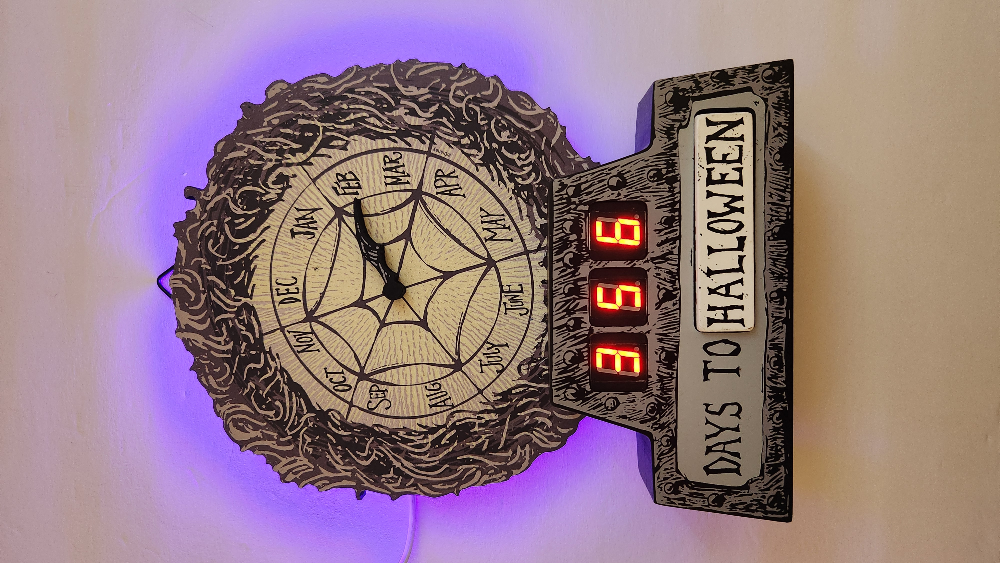
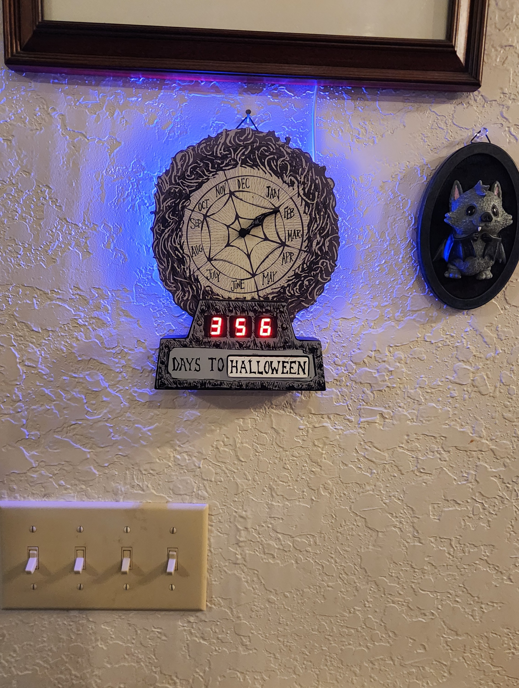
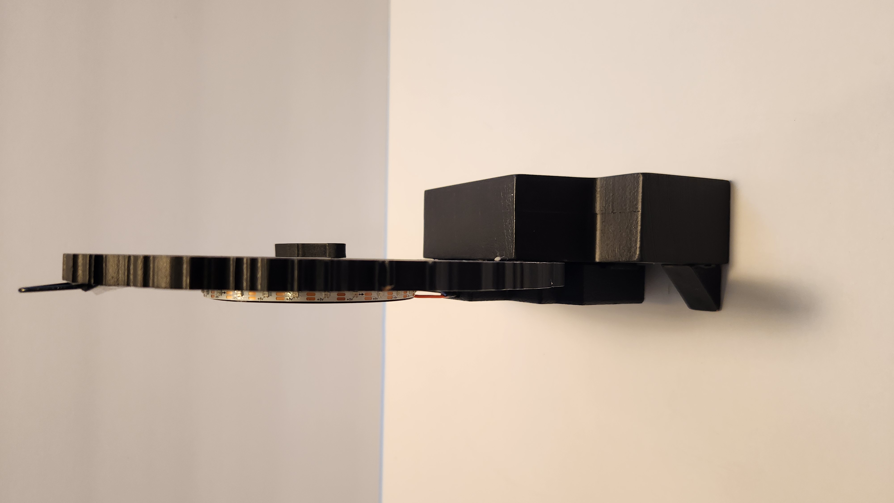
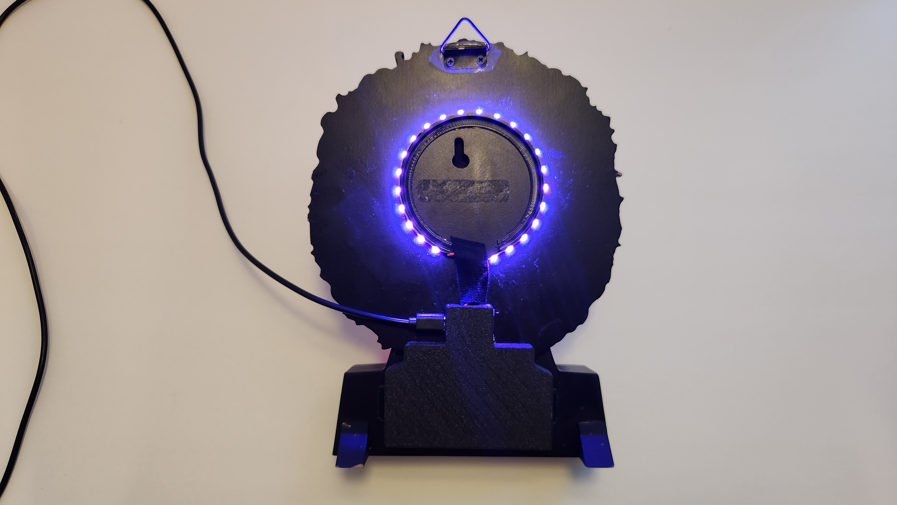

# NBC_Holiday_Countdown_Display

This is the product page landing for the NBC Holiday Countdown display.

This display was sold by Spirit Halloween and has been modified to have a digital display driven by a microcomputer.

## Project Photos

<table>
  <tr>
    <td align="center">
      
    </td>
    <td align="center">
      
    </td>
  </tr>
  <tr>
    <td align="center">
      
    </td>
    <td align="center">
      
    </td>
  </tr>
</table>

## Features

- **Automatic Holiday Countdown** – Displays the days remaining until Halloween or Christmas, automatically advancing to the next occurrence each year.
- **Wi-Fi Setup Portal** – Easily configure your Wi-Fi connection without editing firmware or hardcoding network credentials.
- **Web-Based Controls** – Access the display's control page from a phone, tablet, or computer on your local network.
- **Holiday Selection** – Choose whether the display counts down to Halloween or Christmas.
- **Customizable RGB Background Lighting** – Select your preferred background LED color and adjust brightness using the web interface.
- **Over-the-Air (OTA) Firmware Updates** – Update the display firmware wirelessly without connecting it to a computer.
- **Time Zone Configuration** – Set your local time zone to keep the countdown accurate.

## User Guide

- [View the Web User Guide](https://planedoctor.github.io/NBC_Holiday_Countdown_Display/)
- [Download Printable User Guide (PDF)](User%20Guide/NBC_Holiday_Countdown_User_Guide.pdf)

## Firmware Updates

The latest firmware is available from the project's GitHub Releases page.

[Download the Latest Firmware](../../releases/latest)

## Support

Need help with your Holiday Countdown Display?
Have a question or encountered a problem?

Contact HomeHackery at [HomeHackery1@gmail.com](mailto:HomeHackery1@gmail.com).

We're happy to help!
